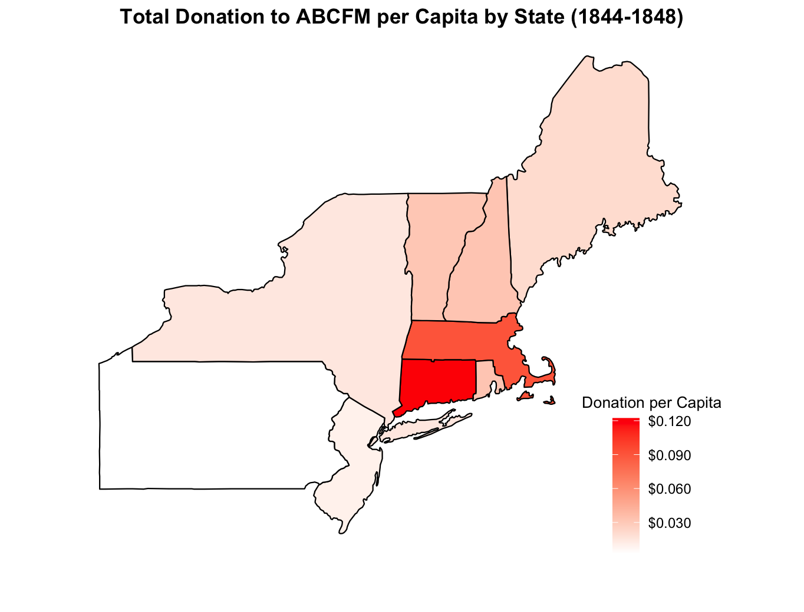
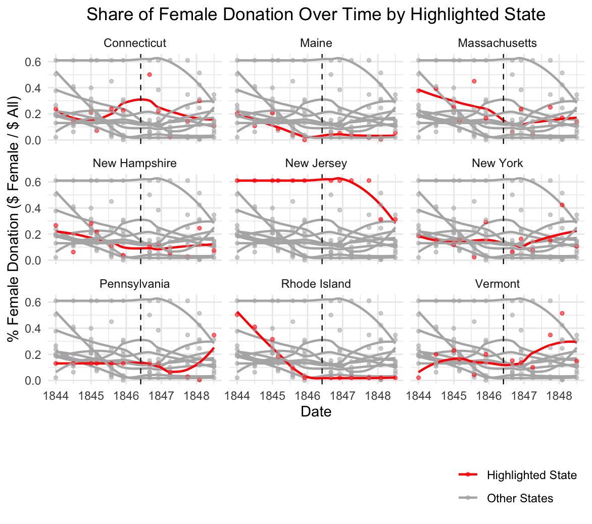

# Charitable Ladies: Female Intra-household Financial Independence in 1840s Northeast United States

**Haley Lin** · ECON 455, Williams College · Spring 2026

📄 [Full paper (PDF)](Charitable%20Ladies%20Female%20Financial%20Independence%201840s.pdf) · 🖼️ [Poster (PDF)](Econ%20455%20Charitable%20Ladies.pdf)

## Summary

Under **coverture**, married women in nineteenth-century America could not make contracts, own property, sue or be sued, and their husbands controlled any wages they earned. Household-level financial data from the period is scarce. This paper proposes **charitable giving** as a first step toward measuring women's financial agency within the household.

Using a new hand-built dataset of donations to the **American Board of Commissioners for Foreign Missions (ABCFM)**, taken from the *Missionary Herald*, the paper tests whether:

1. women in **wealthier and more educated states** gave a larger share of donations, and
2. the female donation share in **Massachusetts** rose after the **1846 Married Women's Property Act**.

**Neither hypothesis is supported.** The paper argues that this mainly shows the limits of the proxy, and of state-level controls, rather than evidence against female bargaining power.

## Conceptual Framework

- **Household bargaining (Chiappori 1992; Ahn & Ren 2025).** Husband and wife have Cobb-Douglas preferences over private goods and public goods, with religious giving treated as a public good. Household utility is $U = U^h + \mu U^w$, where $\mu$ is the wife's bargaining power. Solving gives

  $$\frac{\partial Q_j}{\partial \mu} = \frac{\beta^w_j - \beta^h_j}{(1+\mu)^2}\,x$$

  So giving rises with $\mu$ whenever wives value religious charity more than husbands do, which modern evidence supports.
- **Principal-agent framing of coverture (Geddes & Lueck 2002).** The husband (principal) monitors the wife (agent). When monitoring costs more, the wife has more room to act on her own, so $\mu$ is higher.

**Hypotheses**

| | Prediction |
|---|---|
| H1 | Higher **wealth** means household management is harder to monitor, so the female donation share is higher |
| H2 | Higher **female education** raises the marginal product of labor, which is harder to monitor, so the female donation share is higher |
| H3 | After the **Married Women's Property Act**, wives have market access and higher threat points, so the female share rises differentially |

## Data

- **Donations.** I took *Missionary Herald* volumes for 1844–1848 from the Internet Archive and randomly sampled 12 months (`set.seed(455)`). The donation lists were digitized into a state-month panel for 9 Northeastern states (CT, MA, ME, NH, NJ, NY, PA, RI, VT). A donor is coded as female-related if the name or label contains terms like "Mrs.", "Miss", "Ladies", "Fem.", or "girls".
- **Outcome.** $r_{i,t}$ is female donations ($) divided by total donations ($) in state $i$, month $t$. State-months with fewer than 10 donations are dropped.
- **Covariates.**
  - Income per capita comes from Easterlin (1960) for 1840 and 1880, linearly interpolated.
  - Female educational attainment is the share of school-age girls (5–20) attending school, from the 1850 Census. It does not change over the sample period.
  - Population comes from the 1840 Census.

On average, female-related donors gave about 9% (ME) to 46% (NJ) of total donations in a state-month. Smaller states vary much more from month to month.

<p align="center">
  
  
</p>

## Empirical Strategy & Results

**1. State characteristics** (state and year fixed effects, standard errors clustered by state)

$$r_{i,t} = \alpha + \beta_1 \text{Wealth}_{i,t} + \beta_2 \text{Education}_{i} + \lambda_i + \delta_t + \epsilon_{i,t}$$

- The coefficient on income per capita is positive but **not significant**.
- The coefficient on female education is **negative**, the opposite of the prediction. It is marginally significant on its own (−0.426\*) and becomes insignificant once income is added.

**2. Difference-in-differences around the 1846 Massachusetts Act**

$$r_{i,t} = \alpha + \beta(\text{MA}_i \times \text{Post}_t) + \gamma X_{i,t} + \lambda_i + \delta_t + \epsilon_{i,t}$$

- $\beta$ is **negative and significant** in every specification. With state and year fixed effects, Massachusetts' female share fell **13.9 percentage points** relative to other states after the Act. The prediction was an increase.

## Why the Null Results?

- **Ecological fallacy.** The theory is about bargaining within a household, but the controls are state-level.
- **Sparse and low-frequency covariates.** Education is fixed over the sample, so state fixed effects absorb it. Income is interpolated over a 40-year gap.
- **Omitted controls.** The regressions lack equity-law or community-property regimes, political variables, and sex ratios.
- **A narrow proxy.** Women who gained bargaining power may have spent it on other charities, the church, children, or household goods rather than on the ABCFM.
- **Parallel trends are doubtful.** Massachusetts was already declining before 1846. The DiD estimate is therefore a descriptive divergence, not a causal effect.

**Contribution.** The paper proposes charitable giving as one empirical window into household bargaining in a period with little direct evidence. It also documents the limits of that approach. Women's financial independence in the early 19th century should be understood through informal, partial, and institution-specific channels, not only through formal legal rights.

## Repository Structure

```
.
├── Charitable Ladies Female Financial Independence 1840s.pdf   # Final paper
├── Econ 455 Charitable Ladies.pdf                              # Poster
├── Code/
│   ├── Econ455_Final_Cleaning.R      # Month sampling and compiling raw sheets into a panel
│   ├── Econ455_Final_Statistics.R    # Summary tables, maps, time-series plots, fixest regressions
│   └── *.png                         # Figures used in the paper and poster
└── Data/
    ├── <Mon>_<Year>/                 # Screenshots of Missionary Herald donation lists per sampled month
    ├── Econ455_RawData.xlsx          # Digitized donor-level records, one sheet per month
    ├── Econ455_Final_Clean.xlsx      # State-month panel plus state covariates (analysis input)
    └── Ba5091-5095.numbers           # Historical statistics reference table
```

## Reproducing

The scripts need R with `readxl`, `dplyr`, `tidyr`, `stringr`, `ggplot2`, `maps`, `scales`, `fixest`, `knitr`, and `kableExtra`.

```r
install.packages(c("readxl","dplyr","tidyr","stringr","ggplot2","maps","scales","fixest","knitr","kableExtra"))
```

Both scripts set `file_name` to an absolute local path near the top. Before running, change it to point at `Data/Econ455_RawData.xlsx` (cleaning) or `Data/Econ455_Final_Clean.xlsx` (statistics).

## Key References

- Ahn, S. Y. & Ren, M. (2025). Gender Wage Gap, Bargaining Power, and Charitable Giving of Households. *JPE Microeconomics*, 3(2).
- Boylan, A. M. (1984). Women in Groups: An Analysis of Women's Benevolent Organizations in New York and Boston, 1797–1840. *Journal of American History*, 71(3).
- Chiappori, P.-A. (1992). Collective Labor Supply and Welfare. *JPE*, 100(3).
- Geddes, R. & Lueck, D. (2002). The Gains From Self-Ownership and the Expansion of Women's Rights. *AER*, 92(4).
- Salmon, M. (1982). Women and Property in South Carolina. *William and Mary Quarterly*, 39(4).
- Yörük, B. K. (2010). Charitable Giving by Married Couples Revisited. *Journal of Human Resources*, 45(2).
